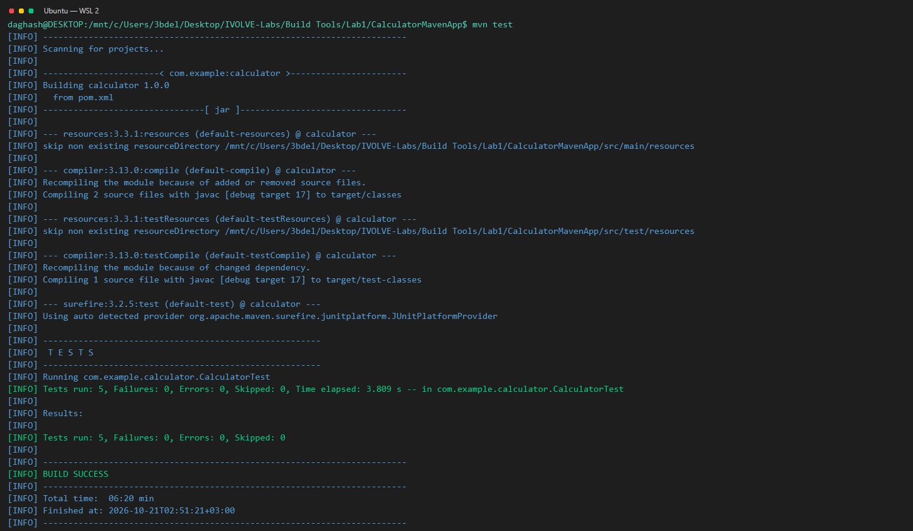
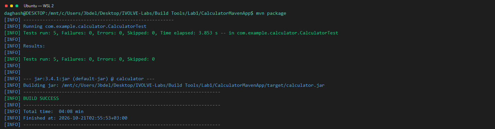
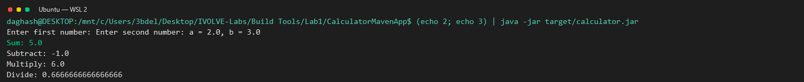

# Lab 1: Building and Packaging a Java Application with Maven

**Goal:** Test, package, and run the Java calculator with Maven.

**Environment:** Ubuntu on WSL 2 with Java 17 and Maven (see the [root README](../../README.md)).

**Source application:** [CalculatorMavenApp on GitHub](https://github.com/Ibrahim-Adel15/CalculatorMavenApp).

## Steps

1. Installed Java 17, Maven, and Git, then checked that Java and Maven were available in the Ubuntu environment.
2. Cloned the Maven calculator project and opened the project directory containing its `pom.xml`.
3. Ran the Maven unit tests. All five tests passed.
4. Packaged the application. Maven completed successfully and produced `target/calculator.jar`.
5. Ran the packaged JAR and supplied `2` and `3` as sample inputs. The calculator returned a sum of `5.0`, a difference of `-1.0`, a product of `6.0`, and a quotient of approximately `0.6667`.
## Result

The Maven tests passed, the executable JAR was created, and the calculator returned the expected results.

*Shows all five Maven tests passing.*

*Shows Maven packaging the calculator JAR successfully.*

*Shows the calculator results for inputs 2 and 3.*
