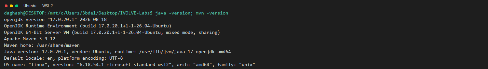

# Lab 1: Build with Maven

Use Maven to test, package, and run the Java calculator in Ubuntu on WSL 2.

## Prerequisites

- Git
- Java Development Kit 17
- Apache Maven

Install the tools in Ubuntu if needed:

```bash
sudo apt update
sudo apt install -y openjdk-17-jdk maven git
java -version
mvn -version
```

## Run the lab

From the repository root, enter the included project:

```bash
cd "Build Tools/Lab1/CalculatorMavenApp"
mvn test
mvn package
ls -lh target/calculator.jar
printf '2\n3\n' | java -jar target/calculator.jar
```

The test suite should report 5 tests with no failures. The runnable JAR should print a sum of `5.0`, subtraction of `-1.0`, multiplication of `6.0`, and division of `0.666...`.

## WSL run evidence

The screenshots below show output from the commands run in WSL.

### Unit tests


### Package and executable JAR


### Calculator output


### Tool versions



## Cleanup

From `CalculatorMavenApp`, remove generated build files while keeping the source:

```bash
rm -rf target
```
