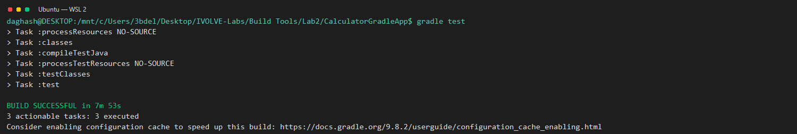
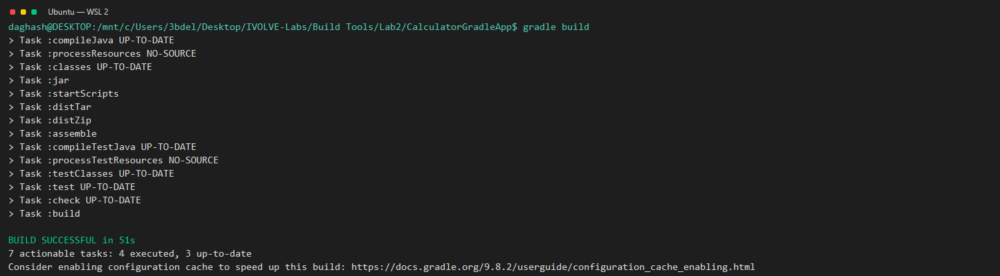
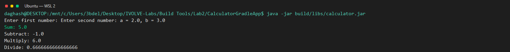

# Lab 2: Building and Packaging the Calculator with Gradle

**Goal:** Test, build, and run the calculator with Gradle.

**Environment:** Ubuntu on WSL 2 with Java 17 and Gradle (see the [root README](../../README.md)).

**Source application:** [CalculatorGradleApp on GitHub](https://github.com/Ibrahim-Adel15/CalculatorGradleApp).

> The PDF labels this a Go application, but the supplied project and the completed work are Java.

## Steps

1. Installed Java 17 and the tools required by SDKMAN, then installed Gradle and checked that both Java and Gradle were available.
2. Cloned the Gradle calculator project, loaded the SDKMAN Gradle environment, and opened the project directory containing `build.gradle`.
3. Ran the Gradle unit tests. The test task completed successfully with no failed tests.
4. Built the application. Gradle completed successfully and produced `build/libs/calculator.jar`.
5. Ran the packaged JAR and supplied `2` and `3` as sample inputs. The calculator returned a sum of `5.0`, a difference of `-1.0`, a product of `6.0`, and a quotient of approximately `0.6667`.
## Result

The Gradle tests and build passed, and the calculator returned the expected results.

*Shows the Gradle tests passing.*

*Shows Gradle creating the executable calculator JAR.*

*Shows the calculator results for inputs 2 and 3.*
