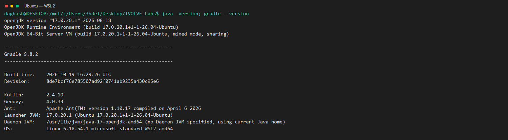

# Lab 2: Build with Gradle

Use Gradle to test, build, and run the Java calculator in Ubuntu on WSL 2.

> The course slide says “Go Application,” but the linked application is Java and produces a `.jar`.

## Prerequisites

- Git
- Java Development Kit 17
- Gradle

Install Java and SDKMAN prerequisites in Ubuntu:

```bash
sudo apt update
sudo apt install -y openjdk-17-jdk git curl zip unzip
```

Install Gradle with SDKMAN if it is not already installed:

```bash
curl -s "https://get.sdkman.io" | bash
source "$HOME/.sdkman/bin/sdkman-init.sh"
sdk install gradle
java -version
gradle --version
```

## Run the lab

From the repository root, enter the included project:

```bash
source "$HOME/.sdkman/bin/sdkman-init.sh"
cd "Build Tools/Lab2/CalculatorGradleApp"
gradle test
gradle build
ls -lh build/libs/calculator.jar
printf '2\n3\n' | java -jar build/libs/calculator.jar
```

The test suite should pass, and the executable JAR should print a sum of `5.0`, subtraction of `-1.0`, multiplication of `6.0`, and division of `0.666...`.

## WSL run evidence

The screenshots below show output from the commands run in WSL.

### Unit tests


### Build and executable JAR


### Calculator output


### Tool versions



## Cleanup

From `CalculatorGradleApp`, remove generated build files while keeping the source:

```bash
rm -rf build
```
