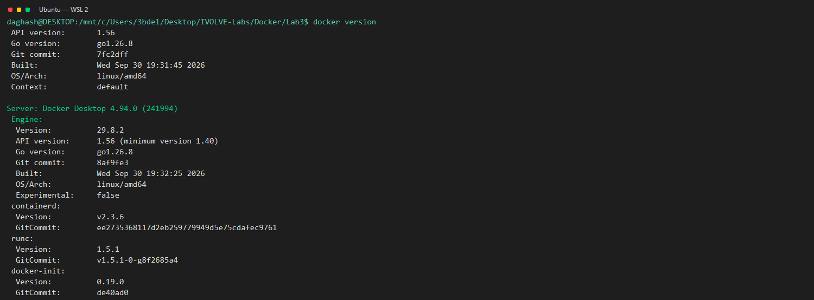

# Lab 3: Build and Compare Docker Images

This lab builds the calculator two ways: compile it inside a Maven image, then compile it locally and copy only its JAR into a Java runtime image.

## Requirements

- Ubuntu on WSL 2
- Docker Desktop running on Windows with Ubuntu enabled under **Settings > Resources > WSL Integration**
- Java 17 and Maven for Part 2

Check that the Docker client can reach its server from Ubuntu:

```bash
docker version
docker run --rm hello-world
```

## Lab parts

1. [Part 1: Build inside Docker](./part1-build-inside-docker/README.md)
2. [Part 2: Build locally](./part2-build-locally/README.md)

The part READMEs contain their commands, expected output, and screenshots.

## Latest WSL results

- Part 1 image build and calculator container run succeeded.
- Part 2 Maven tests and package succeeded; its image build and calculator container run succeeded.
- Both containers printed the expected results for input `2` and `3`.
- Measured Docker-reported disk usage from `docker images`: Part 1 **814 MB**; Part 2 **427 MB**.

These are the sizes reported by Docker Desktop during this run; your values may differ if the base images change.

## Evidence

Screenshots are terminal-style captures rendered from the output of the corresponding WSL commands.

### Docker engine and test container



### Part 1: build and run


### Part 2: test, build, and run


## Cleanup

Use the unique names from the run instructions to remove only the containers and image tags created for this lab:

```bash
docker rm ivolve-lab3-container1 ivolve-lab3-container2
docker image rm ivolve-lab3-app1 ivolve-lab3-app2
```
