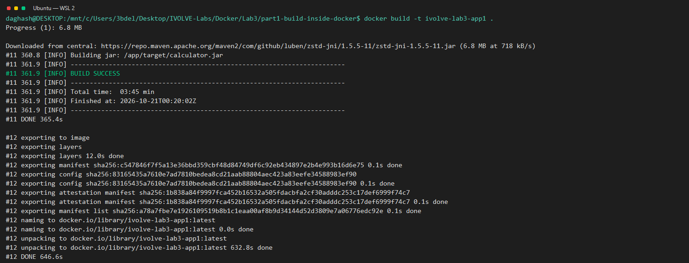
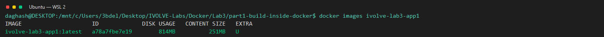
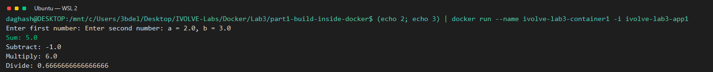
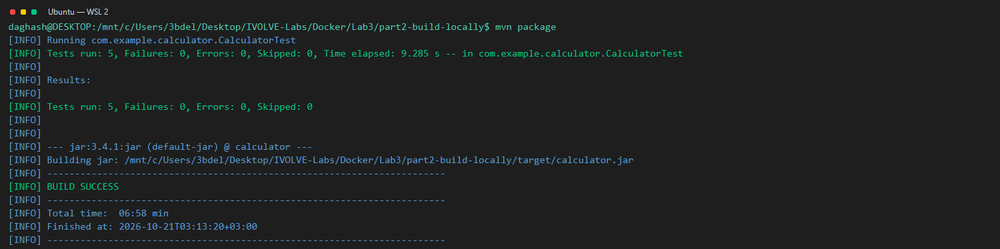
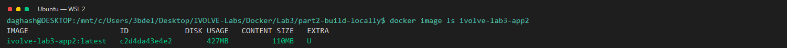
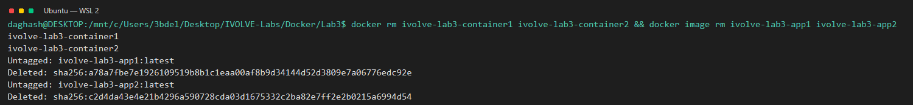

# Lab 3: Docker Image Comparison

**Goal:** Build and compare the calculator image built inside Docker with one built locally.

**Environment:** Ubuntu on WSL 2 (see the [root README](../../README.md)).

## Steps

### Part 1: Build inside Docker

Run these commands from the repository root. The Part 1 Dockerfile is:

```dockerfile
# Image with Maven + Java 17
FROM maven:3.9-eclipse-temurin-17

# Non-root user and a working directory it owns
RUN useradd -m appuser
ENV MAVEN_CONFIG=/home/appuser/.m2
WORKDIR /app
RUN chown appuser:appuser /app

# Copy the source and build the app
COPY --chown=appuser:appuser . .
USER appuser
RUN mvn package

EXPOSE 8080
CMD ["java", "-jar", "target/calculator.jar"]
```

1. Enter the Part 1 build context.

   ```bash
   cd "Docker/Lab3/part1-build-inside-docker"
   ```

   Expect to be in the directory containing the Part 1 Dockerfile.

2. Build the image.

   ```bash
   docker build -t app1 .
   ```

   Expect Docker to build the image and tag it `app1`.

3. Record the image size.

   ```bash
   docker images app1
   ```

   Record the size shown in the `SIZE` column.

4. Run the calculator container.

   ```bash
   printf '2\n3\n' | docker run --name container1 -i app1
   ```

   Expect Sum `5.0`, Subtract `-1.0`, Multiply `6.0`, and Divide `0.666...`.

5. Read the container logs.

   ```bash
   docker logs container1
   ```

   Expect the logs to show the same calculator results.

### Part 2: Build locally

Run these commands from the repository root.

1. Enter the Part 2 build context.

   ```bash
   cd "Docker/Lab3/part2-build-locally"
   ```

   Expect to be in the directory containing the Part 2 `pom.xml`.

2. Run the Maven tests.

   ```bash
   mvn test
   ```

   Expect 5 tests to pass with no failures and `BUILD SUCCESS`.

3. Package the application locally.

   ```bash
   mvn package
   ```

   Expect `BUILD SUCCESS` and `target/calculator.jar` to be created.

The Part 2 Dockerfile is:

```dockerfile
# JRE only, no Maven and no JDK
FROM eclipse-temurin:17-jre

RUN useradd -m appuser
WORKDIR /app

# Copy only the JAR built locally
COPY --chown=appuser:appuser target/calculator.jar app.jar
USER appuser

EXPOSE 8080
CMD ["java", "-jar", "app.jar"]
```

4. Build the image.

   ```bash
   docker build -t app2 .
   ```

   Expect Docker to build the image and tag it `app2`.

5. Record the image size.

   ```bash
   docker images app2
   ```

   Record the size shown in the `SIZE` column.

6. Run the calculator container.

   ```bash
   printf '2\n3\n' | docker run --name container2 -i app2
   ```

   Expect Sum `5.0`, Subtract `-1.0`, Multiply `6.0`, and Divide `0.666...`.

7. Read the container logs.

   ```bash
   docker logs container2
   ```

   Expect the logs to show the same calculator results.

## Result

Both Docker builds and container runs succeeded. The containers printed the expected results.


*Proves Docker built the Part 1 image.*


*Proves the measured size of the Part 1 image.*


*Proves container1 ran the calculator successfully.*


*Proves Maven packaged the Part 2 application.*


*Proves the measured size of the Part 2 image.*


*Proves container2 ran the calculator successfully.*

## Bonus: Compare the image sizes

The sizes below were measured with `docker images` in this repository.

| Image | Measured size |
| --- | ---: |
| `app1` | 814 MB |
| `app2` | 427 MB |

| Comparison | Part 1 (build inside Docker) | Part 2 (build locally) |
| --- | --- | --- |
| Base image | Maven 3.9 with Eclipse Temurin 17 | Eclipse Temurin 17 JRE |
| What is inside the image | Maven, JDK, source, build output, dependencies, and JAR | JRE and application JAR |
| Size | 814 MB | 427 MB |
| Security | Includes build tools and source in the image | Fewer runtime components and a smaller attack surface |
| Needs Java/Maven on the host | No | Yes |
| Reproducibility | Build environment is defined by the Maven image | Depends on the host Java and Maven versions |
| Pull/transfer speed | Slower because the image is larger | Faster because the image is smaller |

Part 2 is smaller because it contains only the JRE and the JAR. It does not include the JDK, Maven, source code, or Maven cache. Part 1 keeps its build environment and dependencies in the image. That makes Part 1 larger.

Part 1 is more reproducible because it does not depend on my machine.

Part 2 is smaller and has less attack surface.

The best of both is a multi-stage build:

```dockerfile
FROM maven:3.9-eclipse-temurin-17 AS build
WORKDIR /build
COPY pom.xml .
COPY src ./src
RUN mvn package

FROM eclipse-temurin:17-jre
RUN useradd -m appuser
WORKDIR /app
COPY --from=build --chown=appuser:appuser /build/target/calculator.jar app.jar
USER appuser
CMD ["java", "-jar", "app.jar"]
```

## Cleanup

Remove the two lab containers and images.

```bash
docker rm container1 container2
docker image rm app1 app2
```


*Proves the lab containers and images were removed.*
