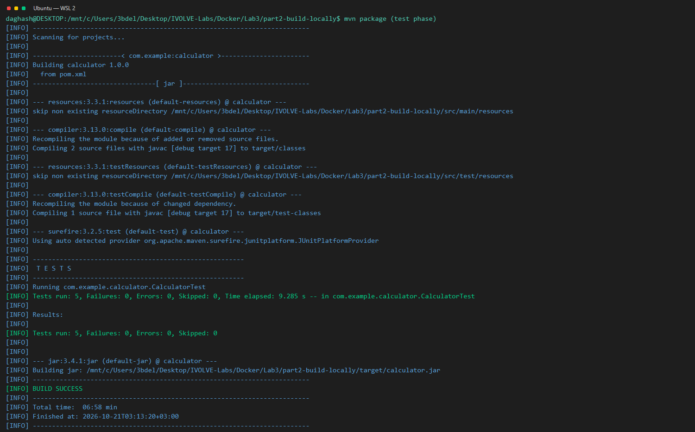
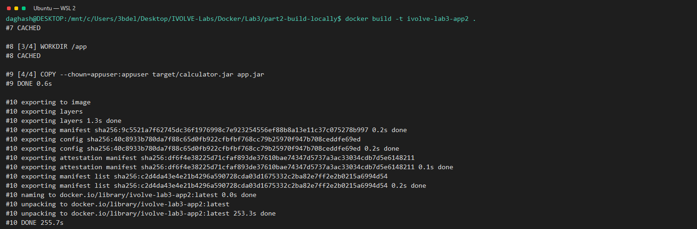

# Lab 3, Part 2: Build Locally

Run Maven tests and package the calculator on the WSL host. Then build a runtime-only Java image using the resulting JAR.

## Test, package, and run locally

From the repository root:

```bash
cd "Docker/Lab3/part2-build-locally"
mvn test
mvn package
ls -lh target/calculator.jar
printf '2\n3\n' | java -jar target/calculator.jar
```

## Build and run the image

From this directory:

```bash
docker build -t ivolve-lab3-app2 .
docker images ivolve-lab3-app2
printf '2\n3\n' | docker run --name ivolve-lab3-container2 -i ivolve-lab3-app2
docker logs ivolve-lab3-container2
```

The calculator should print `Sum: 5.0`, `Subtract: -1.0`, `Multiply: 6.0`, and `Divide: 0.666...`. This image contains the Java runtime and application JAR, but not Maven or the JDK.

## WSL evidence

See the [Lab 3 screenshot folder](../screenshots/).







