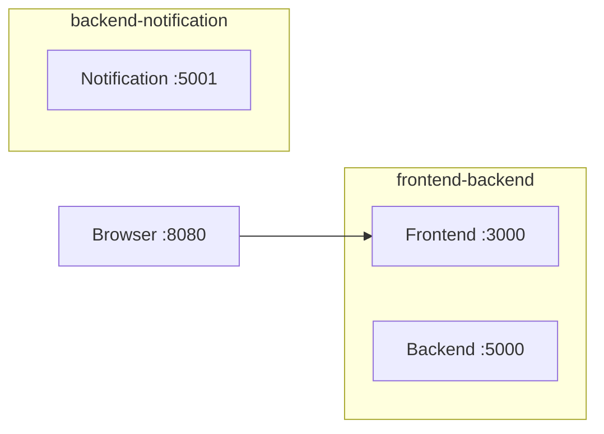

# Lab 7 — Multi-Network Microservices, Volumes, and Bind Mounts

## Overview

This lab runs a frontend, backend, and notification service in Docker containers connected through isolated bridge networks. A bind mount preserves backend messages, and named volumes preserve service logs.

**Environment:** Ubuntu on WSL 2 with Docker Desktop (see the [root README](../../README.md)).

**Source application:** [MicroserviceApp on GitHub](https://github.com/Ibrahim-Adel15/MicroserviceApp).

**Objectives**

- Build Docker images for three services.
- Configure two bridge networks with separate subnets.
- Connect the backend to both networks.
- Persist backend data using a bind mount.
- Persist service logs using named volumes.
- Verify service communication, isolation, and persistence.

## Architecture

| Service | Container port | Network | Responsibility |
| --- | ---: | --- | --- |
| Frontend | 3000 | `frontend-backend` | Web interface |
| Backend | 5000 | Both networks | Processes and stores messages |
| Notification | 5001 | `backend-notification` | Receives notifications |

### Request flow

1. The browser accesses the frontend through host port `8080`.
2. The frontend sends requests to the backend.
3. The backend stores messages and sends notifications.
4. The notification service records received notifications.

The frontend cannot directly resolve the notification service because it is not connected to `backend-notification`.



## Project Structure

```text
Lab7/
├── README.md
├── screenshots/                 # Optional visual evidence
└── app/
    ├── backend/
    │   ├── Dockerfile
    │   ├── app.py
    │   └── requirements.txt
    ├── data/
    ├── frontend/
    │   ├── Dockerfile
    │   ├── app.py
    │   └── requirements.txt
    └── notification/
        ├── Dockerfile
        ├── app.py
        └── requirements.txt
```

## Implementation

### 1. Build the Docker Images

Run from the lab root:

```bash
docker build -t lab7-frontend ./app/frontend
docker build -t lab7-backend ./app/backend
docker build -t lab7-notification ./app/notification
docker images lab7-frontend lab7-backend lab7-notification
```

### 2. Create the Bridge Networks

Create two separate bridge networks. These are the subnets used for this lab:

```bash
docker network create --driver bridge --subnet 172.28.0.0/16 frontend-backend
docker network create --driver bridge --subnet 172.29.0.0/16 backend-notification
docker network inspect frontend-backend backend-notification \
  --format '{{.Name}} -> {{(index .IPAM.Config 0).Subnet}}'
```

User-defined bridge networks provide container-name DNS resolution between containers attached to the same network.

### 3. Create Persistent Storage

```bash
docker volume create backend-logs
docker volume create notification-logs
mkdir -p app/data
```

| Storage | Type | Container mount |
| --- | --- | --- |
| `backend-logs` | Named volume | `/app/logs` |
| `notification-logs` | Named volume | `/app/logs` |
| `app/data/` | Bind mount | `/app/data` |

### 4. Start the Notification Service

```bash
docker run -d \
  --name notification \
  --network backend-notification \
  -v notification-logs:/app/logs \
  lab7-notification
```

### 5. Start the Backend

Start the backend on `backend-notification`, configure the notification URL, and connect it to the frontend network:

```bash
docker run -d \
  --name backend \
  --network backend-notification \
  -e NOTIFICATION_URL=http://notification:5001/notify \
  -v backend-logs:/app/logs \
  -v "$PWD/app/data:/app/data" \
  lab7-backend
docker network connect frontend-backend backend
```

The backend is attached to both networks so it can communicate with the frontend and notification service.

### 6. Start the Frontend

```bash
docker run -d \
  --name frontend \
  --network frontend-backend \
  -p 8080:3000 \
  -e BACKEND_URL=http://backend:5000 \
  lab7-frontend
docker ps
docker network inspect frontend-backend backend-notification \
  --format '{{.Name}}: {{range .Containers}}{{.Name}} {{end}}'
```

## Verification

### 7. Test the Application

Open <http://localhost:8080>, create a few test messages, and verify they appear in the application.

### 8. Verify Data and Logs

```bash
cat app/data/messages.json
docker exec backend tail -n 10 /app/logs/backend.log
docker exec notification tail -n 10 /app/logs/notification.log
```

The message data should be visible in the host directory, while the named volumes store the service logs.

### 9. Verify Network Isolation

The backend should reach the notification service:

```bash
docker exec backend python -c \
  "import urllib.request as u; print(u.urlopen('http://notification:5001/health', timeout=3).read())"
```

The frontend should fail to resolve the notification service because it is not connected to `backend-notification`:

```bash
docker exec frontend python -c \
  "import urllib.request as u; print(u.urlopen('http://notification:5001/health', timeout=3).read())"
```

### 10. Verify Persistence

After creating messages, recreate the backend container using the same bind mount and named volume, then reconnect it to both networks:

```bash
docker rm -f backend
docker run -d \
  --name backend \
  --network backend-notification \
  -e NOTIFICATION_URL=http://notification:5001/notify \
  -v backend-logs:/app/logs \
  -v "$PWD/app/data:/app/data" \
  lab7-backend
docker network connect frontend-backend backend
```

Verify that messages remain available at <http://localhost:8080> and existing log entries are preserved. Do not remove `app/data/` or either named volume during this test.

<!-- Screenshot: Successfully built Docker images -->
<!-- Screenshot: Docker volumes and backend data directory -->
<!-- Screenshot: Running containers and network membership -->
<!-- Screenshot: Application running with successfully created messages -->
<!-- Screenshot: Persistent backend data and service logs -->
<!-- Screenshot: Network isolation and backend connectivity verification -->

## Cleanup

Remove only this lab's containers and resources:

```bash
docker rm -f frontend backend notification
docker network rm frontend-backend backend-notification
docker volume rm backend-logs notification-logs
docker rmi lab7-frontend lab7-backend lab7-notification
```

Keep `app/data/` if you want to preserve the messages stored on the host.

## Key Takeaways

- User-defined bridge networks provide container-name DNS resolution.
- Separate networks can restrict direct communication between services.
- A container can connect to multiple networks when required.
- Named volumes preserve data independently of container lifecycle.
- Bind mounts expose host directories inside containers.
- Verification commands help confirm connectivity, storage, and persistence.
