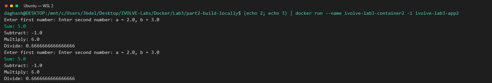

# IVOLVE DevOps Labs

Hands-on build-tools and Docker labs, organized by topic. All labs were run from Ubuntu on WSL 2.

## Repository structure

```text
IVOLVE-Labs/
├── Build Tools/
│   ├── Lab1/
│   │   ├── CalculatorMavenApp/
│   │   ├── screenshots/
│   │   └── README.md
│   └── Lab2/
│       ├── CalculatorGradleApp/
│       ├── screenshots/
│       └── README.md
├── Docker/
│   └── Lab3/
│       ├── part1-build-inside-docker/
│       │   └── README.md
│       ├── part2-build-locally/
│       │   └── README.md
│       ├── screenshots/
│       └── README.md
└── README.md
```

## Labs

### Build Tools

- [Lab 1: Maven](./Build%20Tools/Lab1/README.md) — test, package, and run the Java calculator.
- [Lab 2: Gradle](./Build%20Tools/Lab2/README.md) — test, build, and run the Java calculator.

### Docker

- [Lab 3: Docker](./Docker/Lab3/README.md) — compare building inside Docker with building locally.
  - [Part 1: Build inside Docker](./Docker/Lab3/part1-build-inside-docker/README.md)
  - [Part 2: Build locally](./Docker/Lab3/part2-build-locally/README.md)

## WSL 2 setup

Use an Ubuntu WSL 2 terminal for the lab commands. The required tools are Java 17, Maven, Gradle, and Docker Desktop with WSL integration enabled. See each lab README for its exact prerequisites and commands.

## Latest run results

| Lab | Result |
| --- | --- |
| [Maven](./Build%20Tools/Lab1/README.md) | Tests passed; executable JAR built and calculator output verified. |
| [Gradle](./Build%20Tools/Lab2/README.md) | Tests and build passed; executable JAR output verified. |
| [Docker Part 1](./Docker/Lab3/part1-build-inside-docker/README.md) | Image built, container output verified; measured Docker disk usage: 814 MB. |
| [Docker Part 2](./Docker/Lab3/part2-build-locally/README.md) | Maven tests and package passed; image and container verified; measured Docker disk usage: 427 MB. |

The lab READMEs include terminal-style screenshots captured from the WSL command output.

## Run evidence



