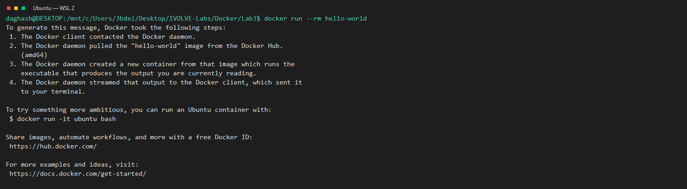

# IVOLVE DevOps Labs

Hands-on labs for Java build tools and Docker.
Each lab includes commands, results, and screenshot evidence.

## Environment

Using Ubuntu on WSL 2 gives the labs Linux shell and tool behavior.
Docker Desktop WSL integration connects Ubuntu to the Docker Engine.
All commands were run as Linux commands in an Ubuntu shell, not Windows PowerShell.

| Operating system | Runtime | Build tool | Build tool | Container engine |
| --- | --- | --- | --- | --- |
| Ubuntu on WSL 2 | Java 17 | Maven | Gradle | Docker Desktop |

*Proves Ubuntu WSL integration is enabled for this environment.*

## Labs

| Lab | What it does | Result |
| --- | --- | --- |
| [Lab 1: Maven](./Build%20Tools/Lab1/README.md) | Tests, packages, and runs the Java calculator with Maven. | Tests passed; JAR output verified. |
| [Lab 2: Gradle](./Build%20Tools/Lab2/README.md) | Tests, builds, and runs the Java calculator with Gradle. | Tests and build passed; JAR output verified. |
| [Lab 3: Docker](./Docker/Lab3/README.md) | Builds and compares the calculator using two Docker approaches. | Both images built and ran; measured sizes: 814 MB and 427 MB. |
